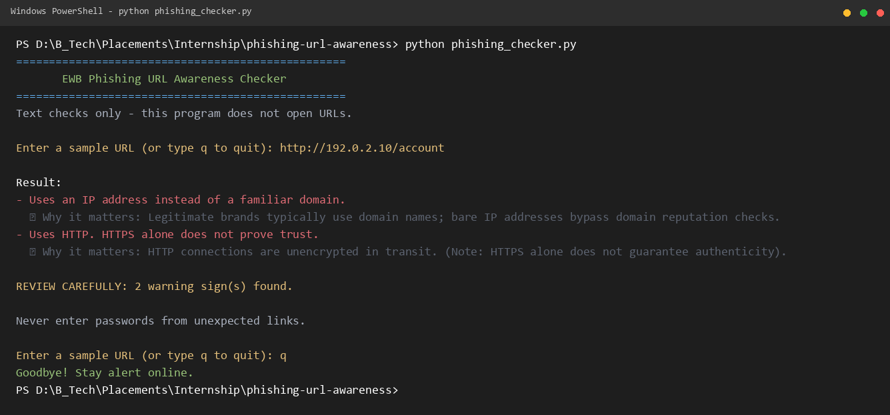
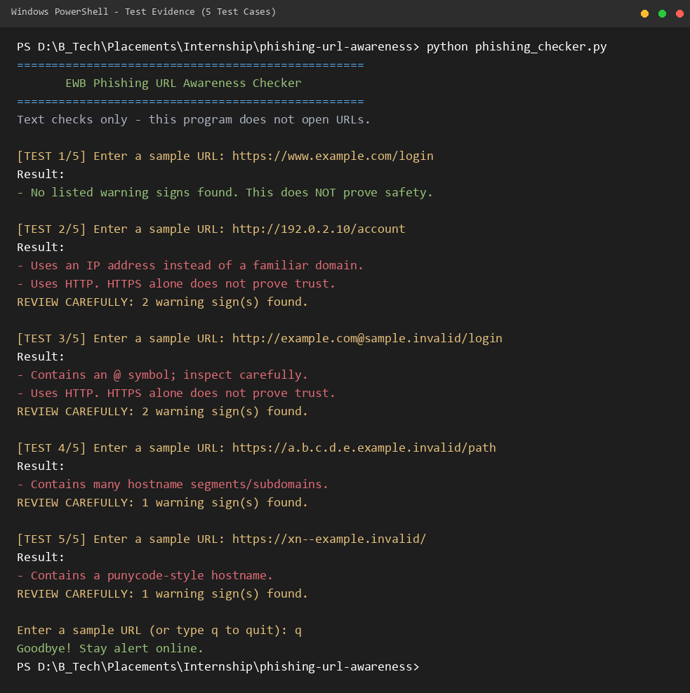

# EWB Phishing URL Awareness Checker

## Overview
Phishing is a social engineering attack where malicious actors deceive users into exposing credentials, payment cards, or sensitive data through misleading links. The **Phishing URL Awareness Checker** is a lightweight, defensive CLI tool written in Python that statically inspects the textual structure of a URL for visible red flags. It operates purely on offline string analysis without resolving, connecting to, or scanning remote servers.

## Features
- **@ Symbol Detection:** Flags user-info delimiters where credentials or deceptive domains precede the true target host.
- **Length Inspection:** Highlights unusually long URLs (exceeding 100 characters) designed to conceal redirection targets.
- **IP-Address Hostname:** Identifies raw IPv4 addresses used instead of registered, human-readable domain names.
- **Excessive Subdomain Segmentation:** Catches hostnames with 5 or more segments intended to mimic trusted subdomains.
- **Punycode Marker (`xn--`):** Flags internationalized domain names (IDNs) often leveraged in homograph spoofing attacks.
- **Insecure Scheme Warning:** Detects unencrypted `http://` connections and clarifies that HTTPS alone is not proof of safety.
- **Continuous Session Loop (Improvement A):** Allows evaluating multiple URLs sequentially with clean exit commands (`q`, `quit`, `exit`).
- **Careful Review Summary & Risk Count (Improvement B):** Summarizes the total warning count when potential hazards are present.
- **Safe Malformed Input Parsing (Improvement C):** Employs exception-handled parsing to prevent terminal crashes on malformed inputs (e.g. invalid IPv6 brackets `http://[bad`).
- **Educational Rationale Explanations (Improvement D):** Accompanies each flagged indicator with a concise cybersecurity context explaining why the pattern is suspicious.

## Requirements
Python 3.10 or later. No extra external packages required (uses only standard library modules `re` and `urllib.parse`).

## How to Run
Clone or download the repository, open a terminal in the project directory, and run:

**Windows:**
```powershell
python phishing_checker.py
```

**Mac / Linux:**
```bash
python3 phishing_checker.py
```

## Example Output
```text
==================================================
       EWB Phishing URL Awareness Checker        
==================================================
Text checks only - this program does not open URLs.

Enter a sample URL (or type q to quit): http://192.0.2.10/account

Result:
- Uses an IP address instead of a familiar domain.
  ↳ Why it matters: Legitimate brands typically use domain names; bare IP addresses bypass domain reputation checks.
- Uses HTTP. HTTPS alone does not prove trust.
  ↳ Why it matters: HTTP connections are unencrypted in transit. (Note: HTTPS alone does not guarantee authenticity).

REVIEW CAREFULLY: 2 warning sign(s) found.

Never enter passwords from unexpected links.

Enter a sample URL (or type q to quit): q
Goodbye! Stay alert online.
```

## Testing
| # | Input | Expected | Actual | Result |
|---|---|---|---|---|
| 1 | `https://www.example.com/login` | No warning signs | No listed warning signs found. This does NOT prove safety. | PASS |
| 2 | `http://192.0.2.10/account` | IP address + HTTP | Uses an IP address instead of a familiar domain. <br> Uses HTTP. HTTPS alone does not prove trust. | PASS |
| 3 | `http://example.com@sample.invalid/login` | @ symbol + HTTP | Contains an @ symbol; inspect carefully. <br> Uses HTTP. HTTPS alone does not prove trust. | PASS |
| 4 | `https://a.b.c.d.e.example.invalid/path` | Many hostname segments | Contains many hostname segments/subdomains. | PASS |
| 5 | `https://xn--example.invalid/` | Punycode-style hostname | Contains a punycode-style hostname. | PASS |

*(Full test logs, edge case analyses, and learning notes are documented in [tests/test_samples.md](tests/test_samples.md).)*

## Screenshots
  


## Improvements
1. **Interactive Session Loop with Clean Exit (Option A):** Replaced one-shot script execution with a `while True` loop and exit commands (`q`, `quit`, `exit`), enabling repeated testing of multiple URLs in a single terminal session without restarting. Tested by inputting successive URLs and exiting cleanly via `q`.
2. **Review Carefully Warning Summary (Option B):** Implemented `has_warnings()` helper to differentiate between informative status messages and genuine risk indicators, printing an explicit count `REVIEW CAREFULLY: X warning sign(s) found` only when warnings occur. Tested against both warning-triggering URLs and benign domains.
3. **Crash Prevention on Malformed Input (Option C):** Wrapped `urlparse(candidate)` in a `try...except ValueError` block to handle irregular URLs such as `http://[bad` gracefully, returning a friendly user message instead of unhandled Python exceptions.
4. **Contextual Risk Explanations (Option D):** Mapped detected warnings to clear plain-English security explanations so users learn *why* an indicator is flagged, turning detection into an awareness learning tool.

## Limitations
This is an educational awareness tool designed strictly for defensive learning. It only performs static string inspection of URL text. It does not resolve DNS, establish network connections, probe target hosts, or scan web pages for malicious payloads. A result showing **"No listed warning signs found" does NOT mean a URL is safe**, as sophisticated attacks can utilize freshly registered look-alike domains without any structural anomalies.

## Ethical Use
Use strictly with reserved sample strings and authorized educational domains. Do not collect credentials, attempt credential harvesting, or use this software to deceive individuals or probe network infrastructure without explicit permission.

## Author
- **Author:** Om Jejurkar
- **Batch / Course:** Cybersecurity Internship (EWB Courses)
- **Organization:** EWB Courses

